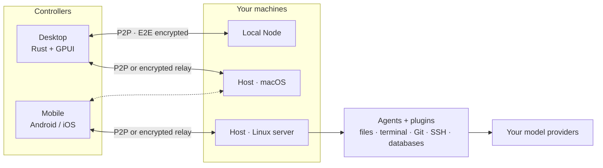

<p align="center">
  
</p>

<h1 align="center">Sailry Harness</h1>

<p align="center">English · <a href="README.zh-CN.md">Chinese (Simplified)</a></p>

<p align="center"><strong>Everything is a plugin. You steer. Agents sail</strong></p>

<p align="center">A native Rust + GPUI workspace on your own models and machines. Agent teams work with files, terminals, Git, SSH and databases; every link is end-to-end encrypted, so your phone can drive any Host.</p>

<p align="center">
  <a href="LICENSE"></a>
  <a href="rust-toolchain.toml"></a>
  <a href="#install"></a>
  <a href="https://github.com/sailry/sailry-harness/stargazers"></a>
  <a href="https://discord.gg/MCDktmDey"></a>
</p>

> [!NOTE]
> **Early preview.** Sailry is under active development, so expect bugs and changes between releases. Back up important work before letting agents edit it, and please [report issues](https://github.com/sailry/sailry-harness/issues) — your feedback shapes what comes next.


## Why Sailry?

| Feature | **Sailry** | [TRAE (China)](https://docs.trae.cn/ide_traework-to-traecode-data-migration) | [WorkBuddy](https://www.codebuddy.cn/docs/workbuddy/Overview) | [Codex](https://learn.chatgpt.com/docs/environments/modes) | [Claude Code](https://code.claude.com/docs/en/overview) | [ZCode](https://zcode.z.ai/en/docs/welcome) | [DSH](https://github.com/deepseek-ai/deepseek-harness) |
| --- | --- | --- | --- | --- | --- | --- | --- |
| Database client | ✅ | — | — | — | — | — | — |
| SSH remote | ✅ | [✅](https://docs.trae.cn/enterprise_feature-list?lang=zh) | — | [✅](https://learn.chatgpt.com/docs/remote-connections) | [✅](https://code.claude.com/docs/en/desktop) | [✅](https://zcode.z.ai/en/docs/remote-development) | ◐ |
| Plugin UI & settings | [✅](sdk/plugins.md) | [◐](https://docs.trae.cn/ide_manage-extensions) | [◐](https://www.codebuddy.cn/docs/workbuddy/Changelog) | [◐](https://learn.chatgpt.com/docs/plugins) | [◐](https://code.claude.com/docs/en/plugins/mods/overview) | [◐](https://zcode.z.ai/en/docs/plugin) | [✅](https://github.com/deepseek-ai/deepseek-harness/blob/master/packages/client/README.md) |
| Fully open source | [✅](LICENSE) | — | — | [◐](https://learn.chatgpt.com/docs/open-source) | [❌](https://github.com/anthropics/claude-code/blob/main/LICENSE.md) | — | [✅](https://github.com/deepseek-ai/deepseek-harness) |
| Remote host tasks | ✅ | [✅](https://docs.trae.cn/ide_ssh-remote) | [◐](https://www.codebuddy.cn/docs/workbuddyapp/features/Multidevice) | [✅](https://learn.chatgpt.com/docs/remote-connections) | [✅](https://code.claude.com/docs/en/desktop) | [✅](https://zcode.z.ai/en/docs/remote-development) | [◐](https://deepseek-harness.github.io/deepseek-harness/en/guide/public-deployments) |
| Phone control | ✅ | [✅](https://forum.trae.cn/t/topic/15182) | [✅](https://www.codebuddy.cn/docs/workbuddyapp/features/Multidevice) | [✅](https://learn.chatgpt.com/docs/remote-connections) | [✅](https://code.claude.com/docs/en/remote-control) | [✅](https://zcode.z.ai/en/docs/welcome) | [◐](https://deepseek-harness.github.io/deepseek-harness/en/guide/public-deployments) |
| Self-hosted execution | ✅ | — | — | [◐](https://learn.chatgpt.com/docs/app-server) | [◐](https://code.claude.com/docs/en/desktop) | [◐](https://zcode.z.ai/en/docs/remote-development) | [✅](https://deepseek-harness.github.io/deepseek-harness/en/guide/public-deployments) |
| Bring your own model | [✅](docs/models.md) | [✅](https://docs.trae.cn/ide_models) | [✅](https://www.codebuddy.cn/docs/workbuddy/From-Beginner-to-Expert-Guide/Function-Description/Model) | [✅](https://learn.chatgpt.com/docs/config-file/config-advanced) | ✅ | [✅](https://zcode.z.ai/en/docs/configuration) | [✅](https://deepseek-harness.github.io/deepseek-harness/en/guide/providers) |
| Git worktrees | [✅](docs/projects.md) | [✅](https://docs.trae.cn/enterprise_feature-list?lang=zh) | ✅ | ✅ | ✅ | — | [◐](https://github.com/deepseek-ai/deepseek-harness/releases) |
| Multi-model subagent teams | ✅ | — | — | ◐ | ◐ | — | ◐ |
| P2P end-to-end encrypted links | ✅ | — | — | ◐ | ◐ | — | ◐ |

✅ Supported · ◐ Partial · 🚧 Coming soon · ❌ Unavailable · — Unconfirmed. Includes official extensions; DSH = DeepSeek Harness.

- **Keep tools together.** Projects, terminals, SSH and databases sit beside the conversation.
- **Extend the workspace.** Plugins add pages, panels, settings, tools and skills via the [Apache-2.0 SDK](sdk/plugins.md).
- **Choose models and hosts.** Use your own model services and connect [execution hosts](docs/hosts.md).

## Agent teams, one model per seat

Sailry agents delegate like a development team: DeepSeek writes the code, Claude
plans the approach, Codex cracks the hard problems — different models in one
session, no glue code. Subagents run in parallel, report back to the lead agent,
and every step stays visible.

## Your desk, your phone, your servers

Desktop and mobile are just controllers. Connect any number of Hosts — a laptop, a
Linux box in the lab, a rented GPU machine — and each one runs tasks on the code
and data already there. Close the laptop and the phone keeps the session alive;
start a task on the phone and watch it finish on the desktop. Nothing is trapped
in one machine.

Every link is end-to-end encrypted. Controllers and Hosts talk peer to peer over
the network when a direct path exists, and fall back to an encrypted relay when it
does not — so you can reach a machine anywhere in the world without opening a port
or trusting a middlebox.



## Install

[Changelog](CHANGELOG.md) · [Report an issue](https://github.com/sailry/sailry-harness/issues)

### Desktop

| Platform | Architecture | Status | Download |
| --- | --- | --- | --- |
| macOS 13+ | Apple silicon / Intel | Supported | [Apple silicon](https://github.com/sailry/sailry-harness/releases/latest/download/Sailry-aarch64-apple-darwin.dmg) · [Intel](https://github.com/sailry/sailry-harness/releases/latest/download/Sailry-x86_64-apple-darwin.dmg) |
| Windows | x64 / ARM64 | Planned | — |
| Linux | x64 / ARM64 | Planned | — |

### Host

Install on a macOS or Linux machine:

```sh
curl -fsSL https://github.com/sailry/sailry-harness/releases/latest/download/install-host.sh | bash
```

| Platform | Architecture | Status | Download |
| --- | --- | --- | --- |
| macOS 13+ | Apple silicon / Intel | Supported | [Apple silicon](https://github.com/sailry/sailry-harness/releases/latest/download/sailry-host-aarch64-apple-darwin.tar.gz) · [Intel](https://github.com/sailry/sailry-harness/releases/latest/download/sailry-host-x86_64-apple-darwin.tar.gz) |
| Linux · glibc 2.34+ | x64 / ARM64 | Supported | [x64](https://github.com/sailry/sailry-harness/releases/latest/download/sailry-host-x86_64-unknown-linux-gnu.tar.gz) · [ARM64](https://github.com/sailry/sailry-harness/releases/latest/download/sailry-host-aarch64-unknown-linux-gnu.tar.gz) |
| Windows | — | Planned | — |

### Mobile

| Platform | Architecture | Status | Download |
| --- | --- | --- | --- |
| Android 7.0+ | ARM64 | Supported | [APK](https://github.com/sailry/sailry-harness/releases/latest/download/Sailry-android-arm64.apk) |
| iOS 15+ | ARM64 | Beta | [TestFlight](https://testflight.apple.com/join/qaTnVrmQ) |

## Get started

Add an existing folder or clone a repository as a project on **Local device** or a connected Host.
Choose **Create session**, pick a model and describe your task; review tool approvals when requested.

## Guides

[Models](docs/models.md) · [Remote hosts](docs/hosts.md) · [Projects and sessions](docs/projects.md)

[Build from source](CONTRIBUTING.md#native-setup)

## Community

For collaboration or to join the group chat, add me on WeChat or join the Discord community.

<p align="center">
  
  <br>
  <a href="https://discord.gg/MCDktmDey"></a>
</p>

> Please use [GitHub Issues](https://github.com/sailry/sailry-harness/issues) for bug reports and feature requests so they are easier to track.

## License

Sailry is licensed under [Apache-2.0](LICENSE), as are the plugin SDK in
[sdk/](sdk/) and the official
[plugins](https://github.com/sailry/sailry-plugins) and
[themes](https://github.com/sailry/sailry-themes) repositories.

The license does not cover the Sailry name or logos; see [TRADEMARKS.md](TRADEMARKS.md).

Third-party materials retain their own licenses; see [NOTICE](NOTICE) and
[third-party notices](third_party_licenses/).

## Contributors

[](https://github.com/sailry/sailry-harness/graphs/contributors)
