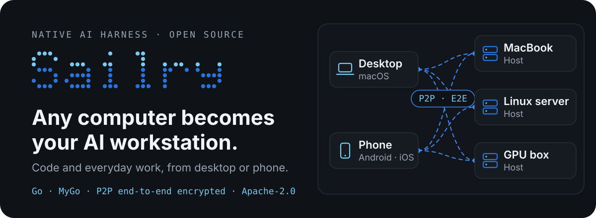
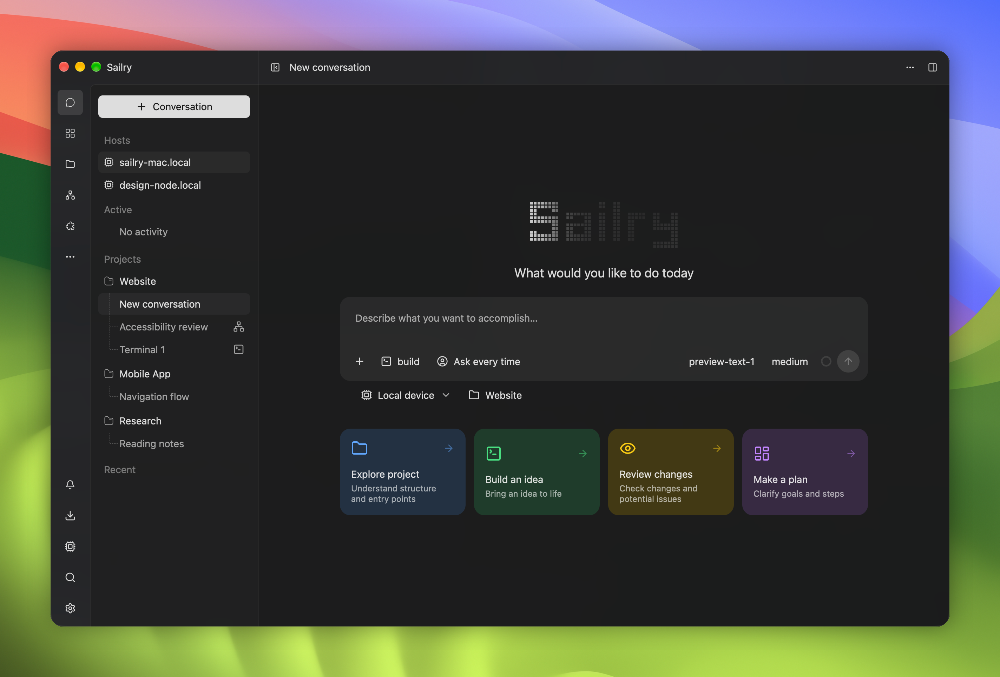
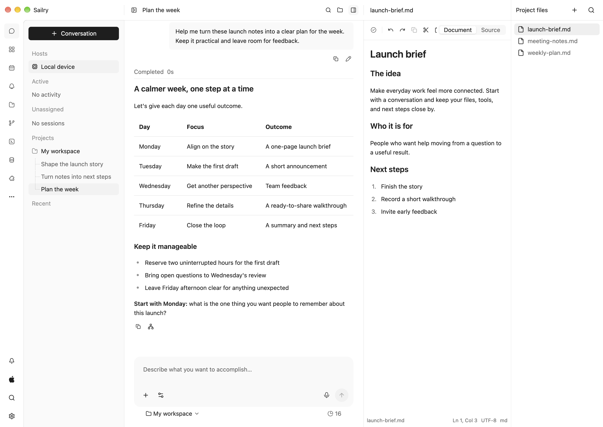
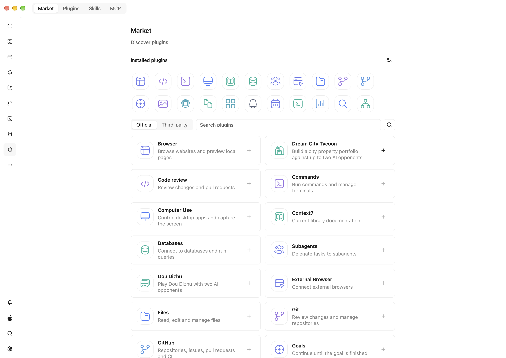

<p align="center">
  
</p>

<p align="center">
  <a href="README.zh-CN.md">简体中文</a> ·
  <a href="#install">Install</a> ·
  <a href="docs/hosts.md">Hosts</a> ·
  <a href="docs/models.md">Models</a> ·
  <a href="sdk/plugins.md">Plugin SDK</a> ·
  <a href="https://discord.gg/MCDktmDey">Discord</a>
</p>

<p align="center">
  <a href="LICENSE"></a>
  <a href="#install"></a>
  <a href="#host"></a>
  <a href="#mobile"></a>
  <a href="https://github.com/sailry/sailry-harness/stargazers"></a>
</p>

Sailry is an open-source AI workspace that runs where your code and data already live.
Install it on any Mac or Linux machine, drive it from the desktop app or your phone, and let
agent teams work with your files, terminals, browser, Git, databases and documents — on the
[models you choose](docs/models.md).

> [!NOTE]
> **Early preview.** Sailry changes quickly between releases. Back up important work before
> agents edit it, and [report issues](https://github.com/sailry/sailry-harness/issues) — your
> feedback shapes what comes next.

<p align="center">
  
</p>

## Any computer becomes your host

Install Sailry Host on a laptop, a Linux box in the lab or a rented GPU machine. It runs as a
background service and keeps projects, terminals and agents on that machine, next to the code
and data they need.

Reach it from the Sailry desktop app or your phone, anywhere in the world. Links go peer to peer
when a direct path exists and fall back to an encrypted relay when it doesn't — no port
forwarding, VPN or cloud account. Close the laptop and the work keeps running on the Host.

## A ChatGPT and Claude Code–class agent, beyond code

One conversation, a complete toolbox:

- **Code** — Standard, Plan and Flagship modes, multi-file `apply_patch` edits, a built-in code
  graph for callers and change impact, Git and worktrees, terminals and code review.
- **Browse and operate** — a built-in browser the agent reads, clicks and screenshots; pick page
  elements straight into the conversation; desktop computer use.
- **Office work** — read Word, Excel, PowerPoint and PDF (with OCR), write documents and
  interactive HTML previews, generate images and video, search the web and your knowledge base.
- **Keep going** — long-term memory, goals that run until they are done, reminders and scheduled
  tasks, and connectors for Notion, Figma, Google Workspace, Microsoft 365, DingTalk, WeCom and
  Yuque.

Where Sailry goes further:

- **Agent teams, one model per seat.** Flagship mode fans work out to parallel subagents, each on
  its own model — DeepSeek writes the code, Claude plans, Codex takes the hard problems — and
  every step stays visible in the conversation.
- **Databases and SSH built in.** Query PostgreSQL, MySQL and SQLite or work on remote servers
  without leaving the session.
- **Searchable history.** Agents find and reuse your earlier conversations.
- **Local speech and OCR.** Voice input and text recognition run on your own machine.

<p align="center">
  
</p>

## Your phone is the remote control

Pair the Android or iOS app with your desktop or any Host using a six-digit code. Pick up any
session, send and queue messages, answer approvals and follow tools as they run — wherever you
are. The connection is peer to peer and end-to-end encrypted, and it is free: no account and no
subscription.

## Native, light and fast

Sailry is written in Rust and drawn on the GPU with GPUI and
[GPUI Kit](https://github.com/dux-web/gpui-component) — no Electron and no bundled browser engine
behind the interface. It starts fast, stays
responsive in long conversations and leaves your memory to your actual work, with less heat and
less lag.

## Extend everything

- **Open standards.** Packages use the [agent-plugins](https://agent-plugins.org) format and
  standard `SKILL.md` skills, and MCP servers connect directly.
- **Native plugin UI.** Plugin pages, panels and settings are written in JavaScript; Sailry
  renders them with native GPUI Kit components, so extensions feel and perform like the rest of
  the app.
- **More models.** Model plugins add providers and accounts.
- Browse the official [plugins](https://github.com/sailry/sailry-plugins) or build your own with
  the Apache-2.0 [SDK](sdk/plugins.md).

<p align="center">
  
</p>

## Polished UI, your theme

The theme system is part of the UI layer itself: colors, typography, surfaces and decorations come
from one set of tokens, in light and dark. Apply themes from the built-in market; official themes
are open packages in [sailry-themes](https://github.com/sailry/sailry-themes).

## Install

[Changelog](CHANGELOG.md) · [Build from source](CONTRIBUTING.md#native-setup)

### Desktop

| Platform | Architecture | Status | Download |
| --- | --- | --- | --- |
| macOS 13+ | Apple silicon / Intel | Supported | [Apple silicon](https://github.com/sailry/sailry-harness/releases/latest/download/Sailry-aarch64-apple-darwin.dmg) · [Intel](https://github.com/sailry/sailry-harness/releases/latest/download/Sailry-x86_64-apple-darwin.dmg) |
| Windows · Linux | x64 / ARM64 | Planned | — |

### Host

Install on a macOS or Linux machine:

```sh
curl -fsSL https://github.com/sailry/sailry-harness/releases/latest/download/install-host.sh | bash
```

| Platform | Architecture | Status | Download |
| --- | --- | --- | --- |
| macOS 13+ | Apple silicon / Intel | Supported | [Apple silicon](https://github.com/sailry/sailry-harness/releases/latest/download/sailry-host-aarch64-apple-darwin.tar.gz) · [Intel](https://github.com/sailry/sailry-harness/releases/latest/download/sailry-host-x86_64-apple-darwin.tar.gz) |
| Linux · glibc 2.34+ | x64 / ARM64 | Supported | [x64](https://github.com/sailry/sailry-harness/releases/latest/download/sailry-host-x86_64-unknown-linux-gnu.tar.gz) · [ARM64](https://github.com/sailry/sailry-harness/releases/latest/download/sailry-host-aarch64-unknown-linux-gnu.tar.gz) |
| Windows | — | Planned | — |

### Mobile

| Platform | Architecture | Status | Download |
| --- | --- | --- | --- |
| Android 7.0+ | ARM64 | Supported | [APK](https://github.com/sailry/sailry-harness/releases/latest/download/Sailry-android-arm64.apk) |
| iOS 15+ | ARM64 | Beta | [TestFlight](https://testflight.apple.com/join/qaTnVrmQ) |

## Get started

1. Add a folder or clone a repository as a project on **Local device** or a connected Host.
2. Choose **Create session**, pick a model and describe your task.
3. [Add a Host and pair your devices](docs/hosts.md#install-and-pair) to work from anywhere.

Guides: [Models](docs/models.md) · [Remote hosts](docs/hosts.md) · [Projects and sessions](docs/projects.md)

## Community

Join the [Discord](https://discord.gg/MCDktmDey) or add the maintainer on WeChat for the group
chat. Please use [GitHub Issues](https://github.com/sailry/sailry-harness/issues) for bug reports
and feature requests.

<p align="center">
  
</p>

## License

Sailry is licensed under [Apache-2.0](LICENSE), as are the plugin SDK in [sdk/](sdk/) and the
official [plugins](https://github.com/sailry/sailry-plugins) and
[themes](https://github.com/sailry/sailry-themes). The license does not cover the Sailry name or
logos; see [TRADEMARKS.md](TRADEMARKS.md). Third-party materials keep their own licenses; see
[NOTICE](NOTICE) and [third-party notices](third_party_licenses/).

[](https://github.com/sailry/sailry-harness/graphs/contributors)
