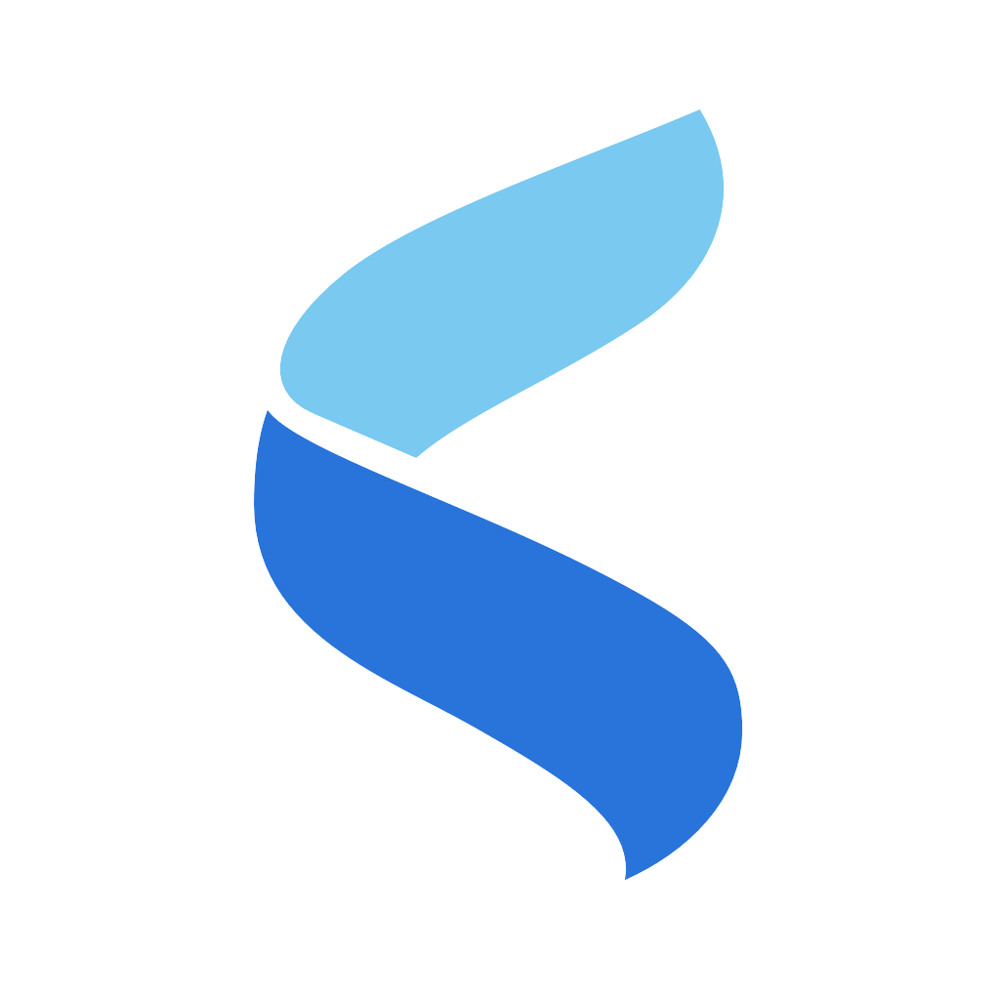
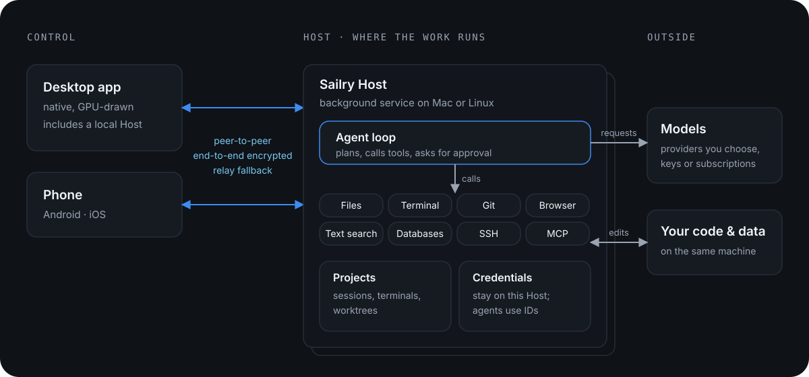

<p align="center">
  
</p>

<h1 align="center">Sailry Harness</h1>

<p align="center">An open-source AI agent runtime and SDK for native apps.</p>

<p align="center">
  <a href="#quick-start">Quick start</a> ·
  <a href="ARCHITECTURE.md">Architecture</a> ·
  <a href="sdk/plugins.md">Plugin SDK</a> ·
  <a href="https://github.com/sailry/sailry-code">Sailry Code</a> ·
  <a href="README.zh-CN.md">简体中文</a>
</p>

<p align="center">
  <a href="LICENSE"></a>
  <a href="https://github.com/sailry/sailry-harness/stargazers"></a>
  <a href="https://discord.gg/MCDktmDey"></a>
  <a href="https://awesomemygo.dev/apps/sailry"></a>
</p>

**Sailry Harness** (`github.com/sailry/sailry-harness`) provides the shared agent runtime, desktop and mobile foundations, and public Go, Flutter, and plugin SDKs. It can also run as a standalone base app.

> [!TIP]
> Looking for the coding app? See [Sailry Code](https://github.com/sailry/sailry-code) and its [end-user releases](https://github.com/sailry/sailry-code/releases).

## Architecture

<p align="center">
  
</p>

- **[Node](internal/node/)** runs agents and tools, enforces approvals, and stores credentials and session history. It runs inside Desktop or as a headless Host.

- **[Link v2](internal/link/)** connects clients and Nodes over end-to-end encrypted libp2p links, with six-digit pairing and automatic relay fallback.

- **[Client](internal/client/)** keeps session and workspace state in sync and recovers after disconnects. Desktop uses [MyGo](https://github.com/egoist/mygo); mobile uses [Flutter](apps/mobile/).

See the [architecture guide](ARCHITECTURE.md) for ownership boundaries, storage, and module dependencies.

## SDKs and extension points

Downstream products use the public [`sdk/`](sdk/) and [`apps/mobile/`](apps/mobile/) packages. Packages under `internal/` are not public APIs.

- **[Go Desktop](sdk/desktop/):** assemble native desktop apps, pages, panels, and settings.
- **[Go Node](sdk/native/node/) and [Host](sdk/host/):** register agent tools and assemble a headless Host.
- **[Flutter mobile](apps/mobile/):** build Android and iOS controllers with product-specific views.
- **[Plugin SDK](sdk/plugins.md):** add JavaScript views and Node tools with [agent-plugins](https://agent-plugins.org), skills, or MCP.

## Built-in general capabilities

The base app assembles reusable [modules](modules/) for agent work modes, parallel subagents, sandboxed commands, and workspace file search.

It also includes browser and desktop automation, Office/PDF and local OCR, HTML previews, media generation, web search, knowledge collections, memory, scheduled tasks, and local dictation. New profiles have no preinstalled plugins or themes.

<a id="install"></a>

## Quick start

Follow [Setup](CONTRIBUTING.md#setup) to install Go 1.27.3 and the prerequisites for your platform, then run from source:

```sh
just native
just desktop
```

- `just desktop dev` uses the isolated `~/.sailry-harness-dev` profile instead of `~/.sailry-harness`.
- `just host` starts a headless Host; `just check` runs the project checks.
- To test Harness changes in Code, use a gitignored `go.work` in your Code checkout that references the local Harness checkout.

Harness APIs are in early preview. [Historical Harness releases](https://github.com/sailry/sailry-harness/releases) remain available for repairs; new end-user packages are published through [Sailry Code](https://github.com/sailry/sailry-code/releases).

## Products and ecosystem

- **[Sailry Code](https://github.com/sailry/sailry-code):** the AI coding workstation built on Harness, with a file workbench, Git and worktrees, terminals, databases, and SSH.
- **[Sailry Plugins](https://github.com/sailry/sailry-plugins):** optional runtime plugins.
- **[Sailry Themes](https://github.com/sailry/sailry-themes):** official light and dark themes.

## Documentation

- **Development:** [Architecture](ARCHITECTURE.md) · [Contributing](CONTRIBUTING.md) · [Engineering rules](AGENTS.md) · [Security policy](SECURITY.md)
- **Runtime guides:** [Models](docs/models.md) · [Remote hosts](docs/hosts.md) · [Projects and sessions](docs/projects.md) · [Relays](docs/relays.md)

## Telemetry, community, and license

### Privacy

Anonymous error reports and feature counts are enabled by default. They do not include conversations, files, credentials, paths, or custom names. Disable them in **Settings → General → Diagnostics and privacy**, or set `SAILRY_TELEMETRY=off` or `DO_NOT_TRACK=1`. Public model benchmarks come from [ModelDial](third_party_licenses/modeldial.md).

### Community

[Discord](https://discord.gg/MCDktmDey) · [GitHub Issues](https://github.com/sailry/sailry-harness/issues)

<p align="center">
  
</p>

### License

[Apache-2.0](LICENSE) · [Trademarks](TRADEMARKS.md) · [Third-party notices](NOTICE) · [Third-party licenses](third_party_licenses/)

[](https://github.com/sailry/sailry-harness/graphs/contributors)
