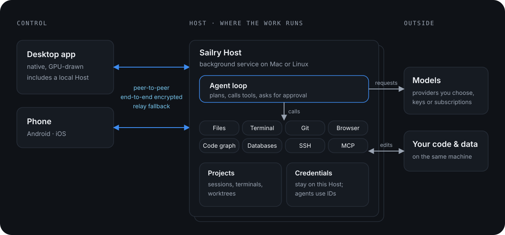

<p align="center">
  
</p>

<p align="center">
  <a href="LICENSE"></a>
  <a href="#install"></a>
  <a href="#install"></a>
  <a href="#install"></a>
  <a href="https://github.com/sailry/sailry-harness/stargazers"></a>
  <a href="https://discord.gg/MCDktmDey"></a>
</p>

<p align="center">
  <a href="README.zh-CN.md">简体中文</a> ·
  <a href="docs/guides/hosts.md">Hosts</a> ·
  <a href="docs/guides/models.md">Models</a> ·
  <a href="docs/guides/projects.md">Projects</a> ·
  <a href="sdk/plugins.md">Plugin SDK</a>
</p>

Sailry is an open-source AI harness: agent teams that run on your own Mac or Linux machines, next
to your code and data, driven from the desktop app or your phone on the
[models you choose](docs/guides/models.md).

> [!NOTE]
> **Early preview.** Sailry changes quickly between releases. Back up important work before
> agents edit it, and [report issues](https://github.com/sailry/sailry-harness/issues) — your
> feedback shapes what comes next.

<p align="center">
  
</p>

## How it works

<p align="center">
  
</p>

- **Any computer becomes a Host.** Install Sailry Host on a laptop, a Linux box in the lab or a
  rented GPU machine. It runs as a background service, so work keeps going when you close the
  laptop.
- **Reach it from anywhere.** No port forwarding, VPN or cloud account.

## Features

### An agent beyond code

- **Code** — three work modes (Standard; Plan, which plans without running code or writing
  files; Flagship, which runs an agent team), multi-file edits, Git and worktrees, terminals
  and code review.
- **Browse and operate** — a built-in browser the agent reads, clicks and screenshots; pick page
  elements straight into the conversation; desktop computer use.
- **Office work** — read Word, Excel, PowerPoint and PDF (with OCR), write documents and
  interactive HTML previews, generate images and video, search the web and your knowledge base.
- **Keep going** — long-term memory, searchable history, goals that run until they are done,
  reminders and scheduled tasks.
- **Connectors** — GitHub, Notion, Slack, Linear, Figma, Google Workspace, Microsoft 365, Feishu,
  DingTalk, WeCom and [more](https://github.com/sailry/sailry-plugins).
- **Local speech and OCR** — voice input and text recognition run on your own machine.

### Agent teams, one model per seat

Flagship mode fans work out to parallel subagents, each on its own model — DeepSeek writes the
code, Claude plans, Codex takes the hard problems — and every step stays visible in the
conversation, where you approve actions as they run.

### Built-in coding tools

Coding plugins work the moment you open a project — no language servers, drivers or extensions to
install. Structured tools return the result the agent needs instead of raw shell output.

- **Code graph** — symbol search, file outlines, callers and callees, change impact and a ranked
  project map, so agents read the right code instead of searching the whole tree.
- **Databases** — PostgreSQL, MySQL and SQLite through saved connections. Queries run read-only;
  writes follow the session's permission policy. Agents use connections by ID and never see
  passwords or private keys.
- **SSH** — commands and SFTP transfers on saved servers, with pinned host keys.

### Your phone is the remote control

Pair the Android or iOS app with your desktop or any Host using a six-digit code. Pick up any
session, send and queue messages, answer approvals and follow tools as they run. No account and
no subscription.

### Native, light and fast

Written in Go and drawn on the GPU with [MyGo](https://github.com/egoist/mygo)'s native UI
toolkit — no Electron and no bundled browser engine.
It starts fast, stays responsive in long conversations and leaves your memory to your work.

### Plugins and themes

- **Open standards** — [agent-plugins](https://agent-plugins.org) packages, standard `SKILL.md`
  skills and direct MCP servers.
- **Native plugin UI** — pages, panels and settings written in JavaScript render with the same
  components as the rest of the app.
- **Themes** — colors, typography, surfaces and decorations come from one set of tokens, in light
  and dark. Official themes live in [sailry-themes](https://github.com/sailry/sailry-themes).
- Browse the official [plugins](https://github.com/sailry/sailry-plugins) or build your own with
  the Apache-2.0 [SDK](sdk/plugins.md).

## Privacy

Sailry sends anonymous error reports (app version, device type and error codes) and anonymous
feature counts by default. They never include conversations, files, credentials, paths or custom
names. Turn either off in **Settings › Diagnostics and privacy**, or set `SAILRY_TELEMETRY=off` or
`DO_NOT_TRACK=1` for the desktop app or a Host.

Sailry downloads public model scores from [ModelDial](third_party_licenses/modeldial.md)
and model metadata from models.dev without sending user data.

## Install

[Changelog](CHANGELOG.md) · [Build from source](CONTRIBUTING.md#setup)

| | Download | Requires |
| --- | --- | --- |
| **Desktop** | macOS: [Apple silicon](https://github.com/sailry/sailry-harness/releases/latest/download/Sailry-aarch64-apple-darwin.dmg) · [Intel](https://github.com/sailry/sailry-harness/releases/latest/download/Sailry-x86_64-apple-darwin.dmg)<br>Windows: [x64](https://github.com/sailry/sailry-harness/releases/latest/download/Sailry-x86_64-pc-windows-msvc-setup.exe) | macOS 13+ · Windows 10+ (x64) · Linux planned |
| **Host** | macOS: [Apple silicon](https://github.com/sailry/sailry-harness/releases/latest/download/sailry-host-aarch64-apple-darwin.tar.gz) · [Intel](https://github.com/sailry/sailry-harness/releases/latest/download/sailry-host-x86_64-apple-darwin.tar.gz)<br>Linux: [x64](https://github.com/sailry/sailry-harness/releases/latest/download/sailry-host-x86_64-unknown-linux-gnu.tar.gz) · [ARM64](https://github.com/sailry/sailry-harness/releases/latest/download/sailry-host-aarch64-unknown-linux-gnu.tar.gz) | macOS 13+ · Linux with glibc 2.34+ · Windows planned |
| **Mobile** | [Android APK](https://github.com/sailry/sailry-harness/releases/latest/download/Sailry-android-arm64.apk) · [iOS TestFlight](https://testflight.apple.com/join/qaTnVrmQ) (beta) | Android 7.0+ · iOS 15+ |

Or install a Host from the terminal:

```sh
curl -fsSL https://github.com/sailry/sailry-harness/releases/latest/download/install-host.sh | bash
```

## Get started

1. [Add a model provider](docs/guides/models.md#add-a-provider) in **Settings → Models** with an
   API key or a ChatGPT or Claude account.
2. Add a folder or clone a repository as a project on **Local device** or a connected Host.
3. Choose **Create session**, pick a model and describe your task.
4. [Add a Host and pair your devices](docs/guides/hosts.md#install-and-pair) to work from anywhere.

Guides: [Models](docs/guides/models.md) · [Remote hosts](docs/guides/hosts.md) · [Projects and sessions](docs/guides/projects.md)

## Community

Join the [Discord](https://discord.gg/MCDktmDey) or add the maintainer on WeChat for the group
chat. Please use [GitHub Issues](https://github.com/sailry/sailry-harness/issues) for bug reports
and feature requests, and [SECURITY.md](SECURITY.md) to report vulnerabilities privately.
Want to contribute? Start with [CONTRIBUTING.md](CONTRIBUTING.md).

<p align="center">
  
</p>

## License

Sailry is licensed under [Apache-2.0](LICENSE), as are the plugin SDK in [sdk/](sdk/) and the
official [plugins](https://github.com/sailry/sailry-plugins) and
[themes](https://github.com/sailry/sailry-themes). The license does not cover the Sailry name or
logos; see [TRADEMARKS.md](TRADEMARKS.md). Third-party materials keep their own licenses; see
[NOTICE](NOTICE) and [third-party notices](third_party_licenses/).

[](https://github.com/sailry/sailry-harness/graphs/contributors)
