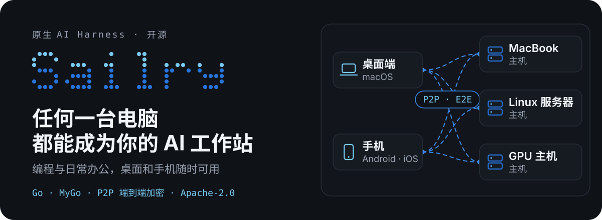
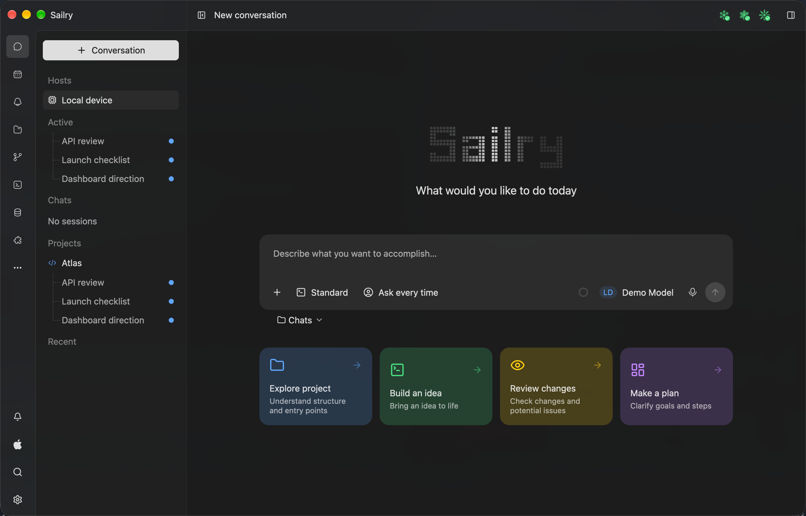
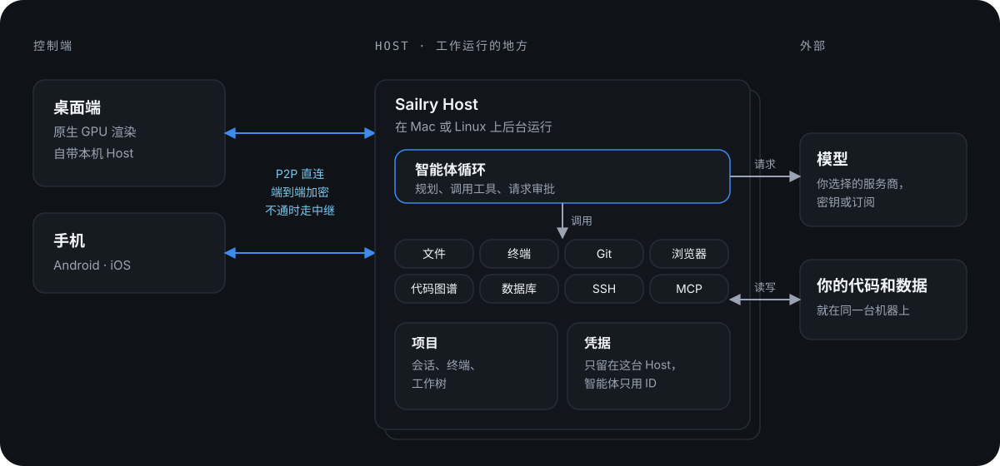

<p align="center">
  
</p>

<p align="center">
  <a href="LICENSE"></a>
  <a href="#安装"></a>
  <a href="#安装"></a>
  <a href="#安装"></a>
  <a href="https://github.com/sailry/sailry-harness/stargazers"></a>
  <a href="https://discord.gg/MCDktmDey"></a>
</p>

<p align="center">
  <a href="README.md">English</a> ·
  <a href="docs/hosts.md">主机</a> ·
  <a href="docs/models.md">模型</a> ·
  <a href="docs/projects.md">项目</a> ·
  <a href="sdk/plugins.md">插件 SDK</a>
</p>

Sailry 是一个开源的 AI Harness：智能体团队运行在你自己的 Mac 或 Linux 机器上，紧挨着你的代码和数据，用桌面端或手机来驱动，模型[由你选择](docs/models.md)。

> [!NOTE]
> **早期预览版。** Sailry 版本之间变化较快。让智能体修改重要文件前请先备份。遇到问题欢迎[提交反馈](https://github.com/sailry/sailry-harness/issues)，你的反馈会直接影响后续开发。

<p align="center">
  
</p>

## 工作方式

<p align="center">
  
</p>

- **任何一台电脑都能成为 Host。** 在笔记本、实验室的 Linux 机器或租来的 GPU 机器上安装 Sailry Host。它作为后台服务运行，合上笔记本也照样继续跑。
- **在哪都能连上。** 不用开端口、不用 VPN、不用云账号。

## 功能

### 不只写代码的智能体

- **编程**：三种工作模式（标准；计划，只做规划、不运行代码也不写文件；旗舰，由智能体团队协作），多文件修改，Git 与 worktree、终端、代码审查。
- **浏览与操作**：智能体能阅读、点击、截图的内置浏览器；页面元素一键选进对话；桌面电脑操作。
- **办公**：读取 Word、Excel、PowerPoint 和 PDF（支持 OCR），撰写文档和可交互的 HTML 预览，生成图片和视频，搜索网络和知识库。
- **持续推进**：长期记忆、可检索的历史会话、做完才停的目标、提醒和定时任务。
- **连接器**：GitHub、Notion、Slack、Linear、Figma、Google Workspace、Microsoft 365、飞书、钉钉、企业微信等，[更多见插件仓库](https://github.com/sailry/sailry-plugins)。
- **本地语音和 OCR**：语音输入和文字识别都在你自己的机器上完成。

### 智能体团队，一个位置一个模型

旗舰模式把任务分给并行的子智能体，每个子智能体用自己的模型——DeepSeek 写代码、Claude 出方案、Codex 攻难题。每一步都在会话里看得见，运行中随时审批。

### 内置编码工具

编码插件打开项目就能用，不用另装语言服务器、驱动或扩展。结构化工具只返回智能体需要的结果，而不是一大段原始 shell 输出。

- **代码图谱**：符号搜索、文件大纲、调用方与被调用方、改动影响分析，以及按引用排序的项目地图，智能体直接读到该读的代码，不用全仓库盲搜。
- **数据库**：通过保存的连接访问 PostgreSQL、MySQL 和 SQLite。查询走只读连接；写操作遵循会话的权限策略。智能体通过 ID 使用连接，看不到密码和私钥。
- **SSH**：在保存的服务器上执行命令、通过 SFTP 传输文件，并固定校验主机密钥。

### 手机就是你的遥控器

用六位配对码把 Android 或 iOS 应用连上桌面端或任意 Host。随时接手任何会话、发送和排队消息、处理审批、查看工具执行过程。不用账号，也没有订阅。

### 原生、轻量、够快

用 Rust 编写，基于 GPUI 和 [GPUI Kit](https://github.com/dux-web/gpui-component) 在 GPU 上绘制界面——没有 Electron，也没有内置浏览器内核。启动快，长会话依然流畅，内存留给真正的工作。

### 插件与主题

- **开放标准**：[agent-plugins](https://agent-plugins.org) 插件包、标准的 `SKILL.md` 技能，MCP 服务器可直接接入。
- **原生插件界面**：用 JavaScript 编写的页面、面板和设置，和应用本身用同一套组件渲染。
- **主题**：颜色、字体、表面和装饰都来自同一套设计令牌，支持亮色和暗色。官方主题维护在 [sailry-themes](https://github.com/sailry/sailry-themes)。
- 浏览官方[插件](https://github.com/sailry/sailry-plugins)，或用 Apache-2.0 的 [SDK](sdk/plugins.md) 编写你自己的插件。

## 隐私

Sailry 默认发送匿名错误报告（应用版本、设备类型和错误代码）和匿名功能使用次数，不包含会话、文件、凭据、路径或自定义名称。可以在**设置 › 诊断与隐私**里分别关闭，也可以给桌面端或 Host 设置 `SAILRY_TELEMETRY=off` 或 `DO_NOT_TRACK=1`。

## 安装

[更新日志](CHANGELOG.md) · [从源码构建](CONTRIBUTING.md#native-setup)

| | 下载 | 系统要求 |
| --- | --- | --- |
| **桌面端** | macOS：[Apple 芯片](https://github.com/sailry/sailry-harness/releases/latest/download/Sailry-aarch64-apple-darwin.dmg) · [Intel](https://github.com/sailry/sailry-harness/releases/latest/download/Sailry-x86_64-apple-darwin.dmg) | macOS 13+ · Windows 和 Linux 计划中 |
| **Host** | macOS：[Apple 芯片](https://github.com/sailry/sailry-harness/releases/latest/download/sailry-host-aarch64-apple-darwin.tar.gz) · [Intel](https://github.com/sailry/sailry-harness/releases/latest/download/sailry-host-x86_64-apple-darwin.tar.gz)<br>Linux：[x64](https://github.com/sailry/sailry-harness/releases/latest/download/sailry-host-x86_64-unknown-linux-gnu.tar.gz) · [ARM64](https://github.com/sailry/sailry-harness/releases/latest/download/sailry-host-aarch64-unknown-linux-gnu.tar.gz) | macOS 13+ · Linux（glibc 2.34+）· Windows 计划中 |
| **移动端** | [Android APK](https://github.com/sailry/sailry-harness/releases/latest/download/Sailry-android-arm64.apk) · [iOS TestFlight](https://testflight.apple.com/join/qaTnVrmQ)（测试版） | Android 7.0+ · iOS 15+ |

也可以在终端里安装 Host：

```sh
curl -fsSL https://github.com/sailry/sailry-harness/releases/latest/download/install-host.sh | bash
```

## 开始使用

1. 在**设置 › 模型**里[添加模型服务商](docs/models.md#add-a-provider)，填 API 密钥或登录 ChatGPT、Claude 账号。
2. 在**本机**或已连接的 Host 上，把现有文件夹或克隆的仓库添加为项目。
3. 选择**创建会话**，选定模型，描述你的任务。
4. [添加 Host 并配对设备](docs/hosts.md#install-and-pair)，随时随地继续工作。

使用指南（英文）：[模型配置](docs/models.md) · [远程主机](docs/hosts.md) · [项目与会话](docs/projects.md)

## 交流与合作

加入 [Discord](https://discord.gg/MCDktmDey)，或加我微信进交流群。Bug 反馈和功能请求请使用[GitHub Issues](https://github.com/sailry/sailry-harness/issues)，更容易跟踪；安全漏洞请按 [SECURITY.md](SECURITY.md) 私下报告。想参与贡献，请先看 [CONTRIBUTING.md](CONTRIBUTING.md)。

<p align="center">
  
</p>

## 许可证

Sailry 采用 [Apache-2.0](LICENSE) 许可证，[sdk/](sdk/) 中的插件 SDK、官方[插件](https://github.com/sailry/sailry-plugins)与[主题](https://github.com/sailry/sailry-themes)同样采用 Apache-2.0。许可证不包含 Sailry 名称和 Logo 的使用权，详见 [TRADEMARKS.md](TRADEMARKS.md)。第三方材料保留各自的许可证，详见 [NOTICE](NOTICE) 和[第三方许可声明](third_party_licenses/)。

[](https://github.com/sailry/sailry-harness/graphs/contributors)
