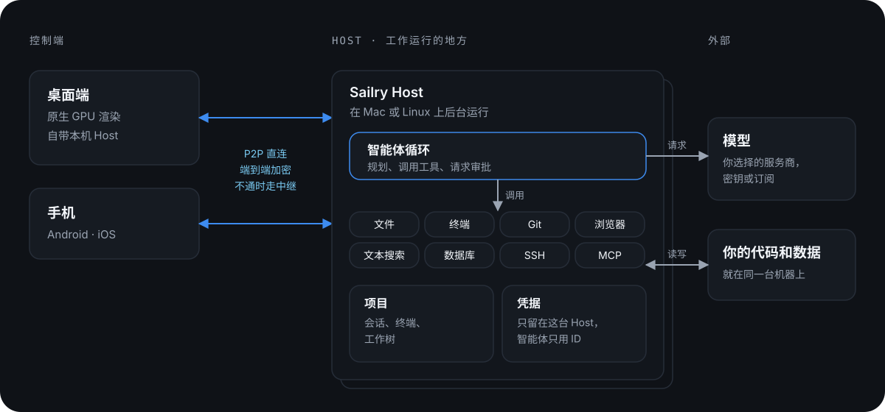

# Sailry Harness

<p align="center">
  <a href="LICENSE"></a>
  <a href="https://github.com/sailry/sailry-harness/stargazers"></a>
  <a href="https://discord.gg/MCDktmDey"></a>
  <a href="https://awesomemygo.dev/apps/sailry"></a>
</p>

<p align="center">
  <a href="README.md">English</a> ·
  <a href="ARCHITECTURE.md">架构文档</a> ·
  <a href="CONTRIBUTING.md">贡献指南</a> ·
  <a href="sdk/plugins.md">插件 SDK</a> ·
  <a href="AGENTS.md">工程规范</a> ·
  <a href="https://github.com/sailry/sailry-code">Sailry Code（用户产品）</a>
</p>

**Sailry Harness**（`github.com/sailry/sailry-harness`）是开源的 AI 智能体运行时框架、Go / Flutter / 插件公共 SDK 以及可独立运行的通用基础应用。它提供本地与远程执行 Node、端到端加密的点对点 Link v2 传输层、Client 状态投影与断线恢复、基于 [MyGo](https://github.com/egoist/mygo) 的原生 GPU 桌面外壳与组件库、Flutter 移动端核心控制器，以及 [`modules/`](modules/) 下的 21 个通用功能模块。

> [!TIP]
> **如果你只是想下载使用 AI 编程工作站：**
> 请直接前往 **[Sailry Code](https://github.com/sailry/sailry-code)**（[Releases 下载](https://github.com/sailry/sailry-code/releases)）。Sailry Code 是基于 Sailry Harness 组装的官方终端产品，集成了原生的文件工作台、Git 与 Worktree、终端、Tree-sitter 代码图谱、数据库与 SSH，并负责全部桌面端 / Host / 移动端安装包发布。

> [!NOTE]
> **早期预览版。** Sailry Harness 的内部实现与 SDK 接口仍在快速演进。框架缺陷与 SDK 问题请提交到 [GitHub Issues](https://github.com/sailry/sailry-harness/issues)。

## 架构概览

<p align="center">
  
</p>

- **Node（`internal/node/`）**：负责智能体执行循环、工具调用、会话权限审批、模型路由、保存在私有配置目录中的凭据以及 SQLite/Turso 规范历史存储，可内嵌于桌面端或通过 Host 无界面运行。
- **Link v2 与中继（`internal/link/`）**：基于 libp2p 的端到端加密 P2P 传输，支持六位配对码配对与 Circuit Relay v2 自动回退，无需公网端口转发、VPN 或云账号。
- **Client（`internal/client/`）**：为桌面端和移动端投影对话流与状态快照，承担断线重连与增量恢复，并统一代理跨主机资源查询。
- **桌面外壳与组件库（`internal/desktop/`）**：使用 [MyGo](https://github.com/egoist/mygo) 在 GPU 上直接渲染原生界面（不嵌入 Electron 或浏览器内核）。业务模块通过公共槽位挂载页面、工作区面板、会话面板与设置项。
- **移动端核心（`apps/mobile/`）**：提供 `sailry_mobile` 与基于 Dart FFI 的 `sailry_bridge`，供下游产品通过 `MobileAssembly` 装配专属项目视图。
- **通用模块（`modules/`）**：21 个与产品形态解耦的通用桌面 / Node 模块，直接参与 Go 编译装配，无需为内置能力引入 JS 桥接开销。

完整的模块依赖表、所有权边界、安全/存储约束以及 GUI 资源生命周期规范请参阅 [ARCHITECTURE.md](ARCHITECTURE.md)。

## 下游产品与生态仓库

| 仓库 | 定位 | 许可证 |
| --- | --- | --- |
| **[Sailry Code](https://github.com/sailry/sailry-code)** | 基于 `sailry-harness` 构建的官方开源 AI 研发工作站；装配 7 个原生开发模块（`code-index`、`files`、`git`、`worktrees`、`terminal`、`databases`、`ssh`），独立维护产品标识（`~/.sailry-code`）与终端用户发布 | Apache-2.0 |
| **[sailry-plugins](https://github.com/sailry/sailry-plugins)** | 官方可选运行时插件集合（默认不预装） | Apache-2.0 |
| **[sailry-themes](https://github.com/sailry/sailry-themes)** | 官方亮色 / 暗色语义主题集合 | Apache-2.0 |

## SDK 与扩展方式

下游 Go / Flutter 产品**单向依赖** [`sdk/`](sdk/) 与 `apps/mobile/` 公共包（禁止导入 `internal/*`，由 CI 强制校验），且新配置目录默认零预装插件和主题：

| 扩展层面 | 公共入口 | 可构建内容 |
| --- | --- | --- |
| **Go 桌面端与产品装配** | `sdk/desktop`、`sdk/desktop/harness`、`sdk/desktop/native`、`sdk/desktop/controls`、`sdk/desktop/theme`、`sdk/desktop/view`、`sdk/desktop/settings`、`sdk/desktop/i18n`、`sdk/desktop/icons`、`sdk/desktop/testing`、`sdk/product`、`sdk/release` | 自定义产品桌面端、品牌标识、更新签名校验、原生 MyGo 视图与设置页 |
| **Go Node 与协议** | `sdk/host`、`sdk/native/node`、`sdk/native/protocol`、`sdk/native/files`、`sdk/native/codeindex`、`sdk/native/link`、`sdk/native/memory`、`sdk/native/process`、`sdk/native/search`、`sdk/native/storage`、`sdk/sdktest` | 自定义无界面 Host、原生 Node 智能体工具、受作用域约束的工作区服务与契约测试 |
| **Flutter 移动端核心** | `apps/mobile/`（`sailry_mobile`、`sailry_bridge`、`MobileAssembly`） | 定制 Android/iOS 移动端遥控器与专属项目资源视图 |
| **运行时插件（`moejs` / MCP）** | [sdk/plugins.md](sdk/plugins.md)、`sdk/desktop/*.d.ts`、`sdk/node/*.d.ts` | 跨平台 JS 原生界面与 Node 回调，同时兼容 [agent-plugins](https://agent-plugins.org)、`SKILL.md` 与 MCP |

## 内置通用能力

作为可运行的通用基础应用，Sailry Harness 默认提供以下能力：

- **工作模式与并行子智能体**：标准（Standard）、计划（Plan 只读规划）与协作（Collaborate 并行子智能体，支持按角色覆盖模型），全程可见执行步骤与审批。
- **核心工作区工具**：沙箱命令执行（`run_command`，含 Linux Bubblewrap 与平台约束）、受路径边界保护的文件读写/编辑/补丁及检索。
- **浏览器与桌面操作**：内置与外部浏览器自动化（`browser`、`external-browser`）及桌面电脑操作（`computer`）。
- **办公、搜索与媒体**：读取 Word/Excel/PowerPoint/PDF（支持本地 OCR）、可交互 HTML 预览、图片与视频生成（`media`）、网络搜索（`web-search`）与本地知识库。
- **持续推进与本地语音**：长期记忆、可检索会话历史、目标/提醒/定时任务、用量统计、服务商额度状态与本地语音听写。

<a id="安装"></a>
## 开发快速上手

按 [CONTRIBUTING.md](CONTRIBUTING.md#setup) 配置前置依赖（**Go 1.27.3**、用于编译本地 Turso 动态库的 **Rust**、移动端所需的 **Flutter**，以及 Linux 沙箱所需的 **Bubblewrap**）后，从源码构建并运行：

```sh
just native
just desktop        # 启动通用基础应用（使用 ~/.sailry-harness）
just desktop dev    # 使用隔离的开发配置目录 ~/.sailry-harness-dev
just host           # 以 .runtime/profiles/host 启动无界面 Host
just check          # 检查格式、构建、运行 vet 和测试
```

- **与 Sailry Code 联调**：在本地 [Sailry Code](https://github.com/sailry/sailry-code) 仓库根目录创建不入库的 `go.work` 指向 `../sailry-go`，Code 的 `dev.sh` 即可直接使用你的本地 Harness 修改运行测试与桌面端。
- **版本发布**：[Sailry Harness Releases](https://github.com/sailry/sailry-harness/releases) 仅保留历史修复版本；新的终端用户安装包统一由 [Sailry Code Releases](https://github.com/sailry/sailry-code/releases) 发布。

## 文档索引

- **框架与工程文档**：[架构文档](ARCHITECTURE.md) · [贡献与 CI 指南](CONTRIBUTING.md) · [工程规范](AGENTS.md) · [插件 SDK v1](sdk/plugins.md) · [安全策略](SECURITY.md)
- **共享运行时指南**（同步至 `sailry.dev/docs/`）：[模型配置](docs/models.md) · [远程主机](docs/hosts.md) · [项目与会话](docs/projects.md) · [中继部署](docs/relays.zh-CN.md)

## 遥测、社区与许可证

程序默认发送匿名错误报告和匿名功能计数（不包含对话、文件、凭据、路径或自定义名称），可在 **设置 › 通用 › 诊断与隐私** 中分别关闭，或设置环境变量 `SAILRY_TELEMETRY=off` / `DO_NOT_TRACK=1`。公开模型评分元数据源自 [ModelDial](third_party_licenses/modeldial.md)。

欢迎加入 [Discord](https://discord.gg/MCDktmDey) 或扫描下方微信二维码进入交流群；Bug 与需求请提交到 [GitHub Issues](https://github.com/sailry/sailry-harness/issues)。

<p align="center">
  
</p>

本项目基于 [Apache-2.0](LICENSE) 开源（包括 [`sdk/`](sdk/)、[sailry-plugins](https://github.com/sailry/sailry-plugins) 与 [sailry-themes](https://github.com/sailry/sailry-themes)）。Sailry 名称和商标权益见 [TRADEMARKS.md](TRADEMARKS.md)；第三方许可声明见 [NOTICE](NOTICE) 与 [third_party_licenses/](third_party_licenses/)。

[](https://github.com/sailry/sailry-harness/graphs/contributors)
