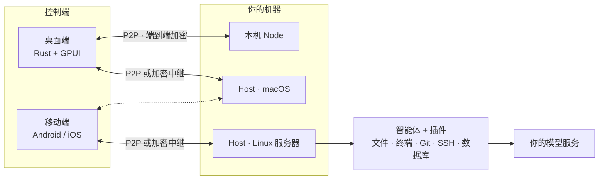

<p align="center">
  
</p>

<h1 align="center">Sailry Harness</h1>

<p align="center"><a href="README.md">English</a> · 简体中文</p>

<p align="center"><strong>一切皆插件。你掌舵，AI 远航</strong></p>

<p align="center">Rust + GPUI 原生工作区，模型和机器你自己选。智能体团队直接操作文件、终端、Git、SSH 和数据库；链路端到端加密，手机随时接上任意主机。</p>

<p align="center">
  <a href="LICENSE"></a>
  <a href="rust-toolchain.toml"></a>
  <a href="#安装"></a>
  <a href="https://github.com/sailry/sailry-harness/stargazers"></a>
  <a href="https://discord.gg/MCDktmDey"></a>
</p>

> [!NOTE]
> **早期预览版。** Sailry 仍在快速开发中，可能存在 bug，版本之间也会有较大变化。让智能体修改重要文件前请先备份。遇到问题欢迎[提交反馈](https://github.com/sailry/sailry-harness/issues)，你的反馈会直接影响后续开发。


## 为什么选择 Sailry？

| 功能 | **Sailry** | [TRAE 中国版](https://docs.trae.cn/ide_traework-to-traecode-data-migration) | [WorkBuddy](https://www.codebuddy.cn/docs/workbuddy/Overview) | [Codex](https://learn.chatgpt.com/docs/environments/modes) | [Claude Code](https://code.claude.com/docs/en/overview) | [ZCode](https://zcode.z.ai/en/docs/welcome) | [DSH](https://github.com/deepseek-ai/deepseek-harness) |
| --- | --- | --- | --- | --- | --- | --- | --- |
| 数据库客户端 | ✅ | — | — | — | — | — | — |
| SSH 远程 | ✅ | [✅](https://docs.trae.cn/enterprise_feature-list?lang=zh) | — | [✅](https://learn.chatgpt.com/docs/remote-connections) | [✅](https://code.claude.com/docs/en/desktop) | [✅](https://zcode.z.ai/en/docs/remote-development) | ◐ |
| 插件界面与设置 | [✅](sdk/plugins.md) | [◐](https://docs.trae.cn/ide_manage-extensions) | [◐](https://www.codebuddy.cn/docs/workbuddy/Changelog) | [◐](https://learn.chatgpt.com/docs/plugins) | [◐](https://code.claude.com/docs/en/plugins/mods/overview) | [◐](https://zcode.z.ai/en/docs/plugin) | [✅](https://github.com/deepseek-ai/deepseek-harness/blob/master/packages/client/README.md) |
| 完整开源 | [✅](LICENSE) | — | — | [◐](https://learn.chatgpt.com/docs/open-source) | [❌](https://github.com/anthropics/claude-code/blob/main/LICENSE.md) | — | [✅](https://github.com/deepseek-ai/deepseek-harness) |
| 远程主机任务 | ✅ | [✅](https://docs.trae.cn/ide_ssh-remote) | [◐](https://www.codebuddy.cn/docs/workbuddyapp/features/Multidevice) | [✅](https://learn.chatgpt.com/docs/remote-connections) | [✅](https://code.claude.com/docs/en/desktop) | [✅](https://zcode.z.ai/en/docs/remote-development) | [◐](https://deepseek-harness.github.io/deepseek-harness/en/guide/public-deployments) |
| 手机控制 | ✅ | [✅](https://forum.trae.cn/t/topic/15182) | [✅](https://www.codebuddy.cn/docs/workbuddyapp/features/Multidevice) | [✅](https://learn.chatgpt.com/docs/remote-connections) | [✅](https://code.claude.com/docs/en/remote-control) | [✅](https://zcode.z.ai/en/docs/welcome) | [◐](https://deepseek-harness.github.io/deepseek-harness/en/guide/public-deployments) |
| 自托管执行服务 | ✅ | — | — | [◐](https://learn.chatgpt.com/docs/app-server) | [◐](https://code.claude.com/docs/en/desktop) | [◐](https://zcode.z.ai/en/docs/remote-development) | [✅](https://deepseek-harness.github.io/deepseek-harness/en/guide/public-deployments) |
| 自带模型 | [✅](docs/models.md) | [✅](https://docs.trae.cn/ide_models) | [✅](https://www.codebuddy.cn/docs/workbuddy/From-Beginner-to-Expert-Guide/Function-Description/Model) | [✅](https://learn.chatgpt.com/docs/config-file/config-advanced) | ✅ | [✅](https://zcode.z.ai/en/docs/configuration) | [✅](https://deepseek-harness.github.io/deepseek-harness/en/guide/providers) |
| Git worktree | [✅](docs/projects.md) | [✅](https://docs.trae.cn/enterprise_feature-list?lang=zh) | ✅ | ✅ | ✅ | — | [◐](https://github.com/deepseek-ai/deepseek-harness/releases) |
| 多模型子代理团队 | ✅ | — | — | ◐ | ◐ | — | ◐ |
| P2P 端到端加密连接 | ✅ | — | — | ◐ | ◐ | — | ◐ |

✅ 支持 · ◐ 部分支持 · 🚧 即将推出 · ❌ 不支持 · — 未确认。含官方扩展；DSH 指 DeepSeek Harness。

- **工具集中使用。** 项目、终端、SSH 和数据库就在对话旁边。
- **工作区可以扩展。** 插件通过 [Apache-2.0 SDK](sdk/plugins.md) 添加页面、面板、设置、工具和技能。
- **模型与主机自己选。** 接入自己的模型服务，连接[执行主机](docs/hosts.md)。

## 智能体团队，一个位置一个模型

Sailry 的智能体像一支开发团队：DeepSeek 负责写代码，Claude 出方案，Codex 解决难题——
一次会话里混用不同模型，无需胶水代码。子代理并行工作、结果回传给主代理，每一步都看得见。

## 桌面、手机、你的服务器

桌面端和移动端只是控制器。接上任意多个 Host——你的笔记本、实验室里的 Linux
机器、租来的 GPU 机器——每个 Host 都在自己熟悉的代码和数据上执行任务。合上笔记本，
手机上的会话照常继续；在手机上下发任务，回桌面端看它跑完。任务不被绑死在任何一台机器上。

链路全程端到端加密。能直连就走 P2P，直连不通就走加密中继——全球任意主机
都能连上，不必开放端口，也不必信任中间节点。



## 安装

[更新日志](CHANGELOG.md) · [反馈问题](https://github.com/sailry/sailry-harness/issues)

### 桌面端

| 系统 | 架构 | 状态 | 下载 |
| --- | --- | --- | --- |
| macOS 13+ | Apple 芯片 / Intel | 支持 | [Apple 芯片](https://github.com/sailry/sailry-harness/releases/latest/download/Sailry-aarch64-apple-darwin.dmg) · [Intel](https://github.com/sailry/sailry-harness/releases/latest/download/Sailry-x86_64-apple-darwin.dmg) |
| Windows | x64 / ARM64 | 计划中 | — |
| Linux | x64 / ARM64 | 计划中 | — |

### Host

在 macOS 或 Linux 机器上安装：

```sh
curl -fsSL https://github.com/sailry/sailry-harness/releases/latest/download/install-host.sh | bash
```

| 系统 | 架构 | 状态 | 下载 |
| --- | --- | --- | --- |
| macOS 13+ | Apple 芯片 / Intel | 支持 | [Apple 芯片](https://github.com/sailry/sailry-harness/releases/latest/download/sailry-host-aarch64-apple-darwin.tar.gz) · [Intel](https://github.com/sailry/sailry-harness/releases/latest/download/sailry-host-x86_64-apple-darwin.tar.gz) |
| Linux · glibc 2.34+ | x64 / ARM64 | 支持 | [x64](https://github.com/sailry/sailry-harness/releases/latest/download/sailry-host-x86_64-unknown-linux-gnu.tar.gz) · [ARM64](https://github.com/sailry/sailry-harness/releases/latest/download/sailry-host-aarch64-unknown-linux-gnu.tar.gz) |
| Windows | — | 计划中 | — |

### 移动端

| 系统 | 架构 | 状态 | 下载 |
| --- | --- | --- | --- |
| Android 7.0+ | ARM64 | 支持 | [APK](https://github.com/sailry/sailry-harness/releases/latest/download/Sailry-android-arm64.apk) |
| iOS 15+ | ARM64 | 测试版 | [TestFlight](https://testflight.apple.com/join/qaTnVrmQ) |

## 开始使用

在本机或已连接的 Host 上，将现有文件夹或克隆的仓库添加为项目。
选择**创建会话**，选定模型后描述任务；需要时确认工具操作。

## 使用指南（英文）

[模型配置](docs/models.md) · [远程主机](docs/hosts.md) · [项目与会话](docs/projects.md)

[从源码构建](CONTRIBUTING.md#native-setup)

## 交流与合作

有相关合作或想加入交流群，可以加我微信，或直接加入 Discord 社区：

<p align="center">
  
  <br>
  <a href="https://discord.gg/MCDktmDey"></a>
</p>

> Bug 反馈和功能请求请使用 [GitHub Issues](https://github.com/sailry/sailry-harness/issues)，更容易跟踪。

## 许可证

Sailry 采用 [Apache-2.0](LICENSE) 许可证，[sdk/](sdk/) 中的插件 SDK、
官方[插件](https://github.com/sailry/sailry-plugins)与
[主题](https://github.com/sailry/sailry-themes)仓库同样采用 Apache-2.0。

许可证不包含 Sailry 名称和 Logo 的使用权，详见 [TRADEMARKS.md](TRADEMARKS.md)。

第三方材料保留各自的许可证，详见 [NOTICE](NOTICE) 和[第三方许可声明](third_party_licenses/)。

## 贡献者

[](https://github.com/sailry/sailry-harness/graphs/contributors)
