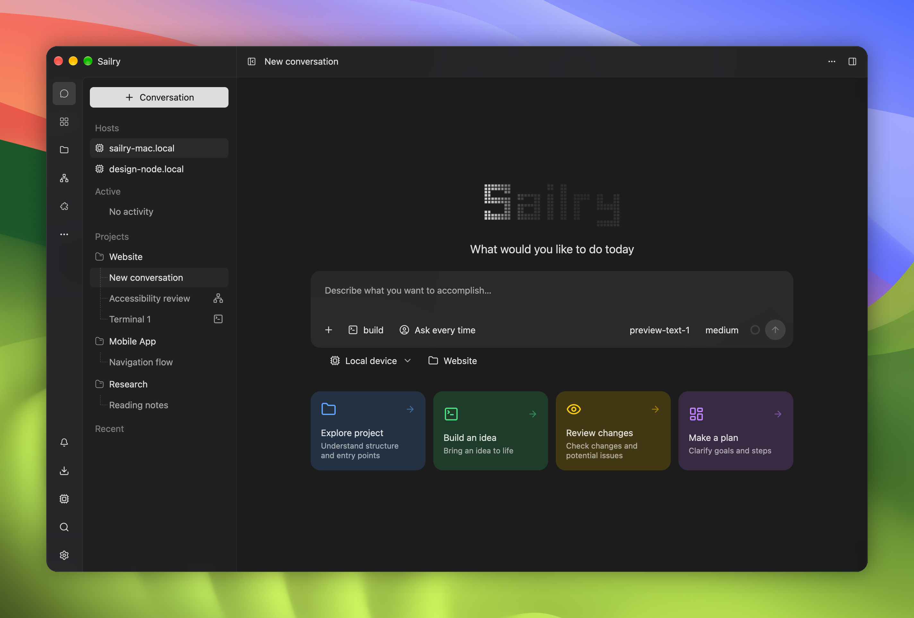
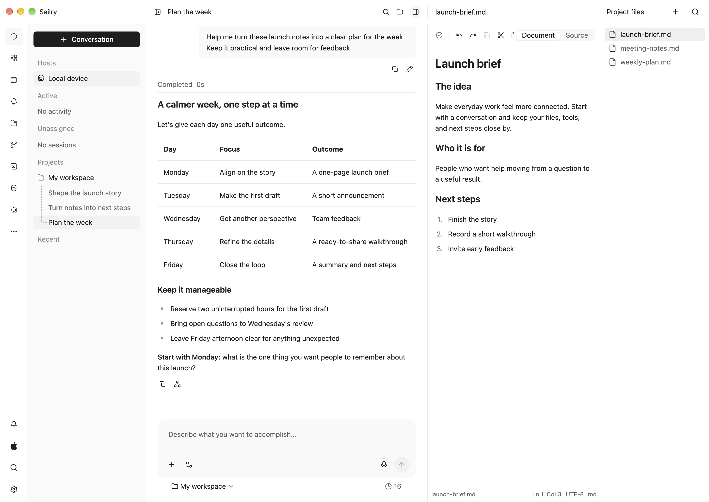
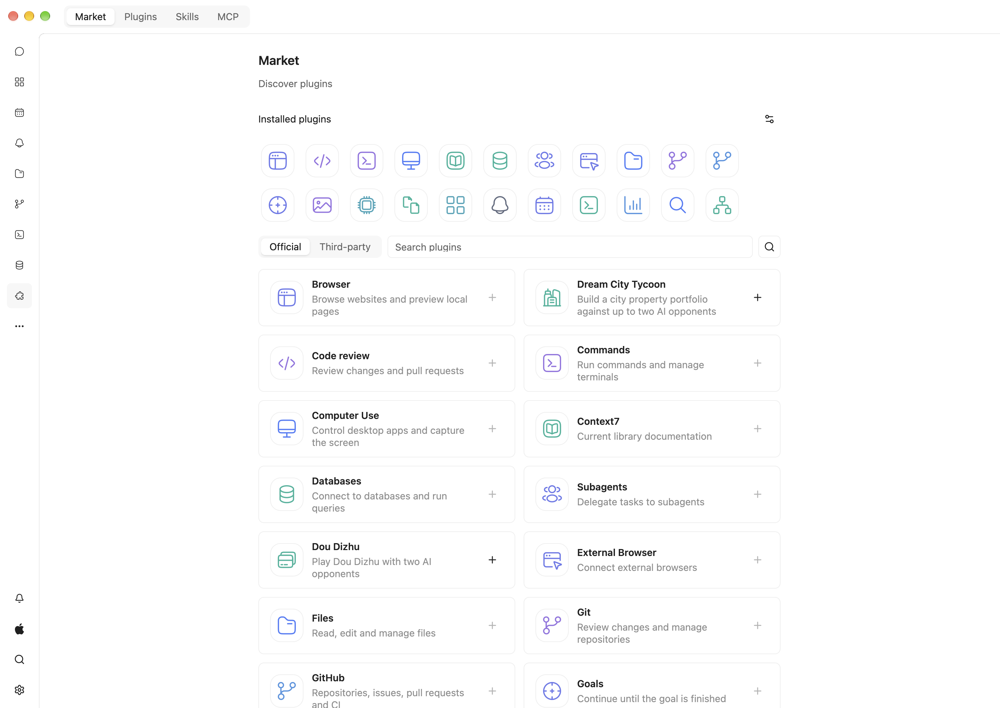

<p align="center">
  
</p>

<h1 align="center">Sailry Harness</h1>

<p align="center">
  <a href="README.md">English</a> · 简体中文
</p>

<p align="center"><strong>面向编码与日常工作的原生 AI 工作区</strong></p>

<p align="center">
  智能体在你自己的机器上运行，任何设备都能接着做。
</p>

<p align="center">
  <a href="https://github.com/sailry/sailry-harness/releases">下载版本</a> ·
  <a href="CHANGELOG.md">更新日志</a> ·
  <a href="https://github.com/sailry/sailry-harness/issues">反馈</a>
</p>



Sailry Harness 是一个 **AI 智能体工作区（AI Agent Harness）**：它把模型、智能体、
上下文、工具和权限组织在同一个原生工作区里，让你随时查看并引导正在进行的工作。

你可以用它编写与审查代码、研究主题、准备文档、查询数据库，或让长期任务在服务器上持续运行。
模型服务和执行工作的电脑都由你选择，Sailry 负责提供围绕它们的工作区。

## 为什么选择 Sailry

多数 AI 智能体应用把工作绑在你眼前的这个窗口上：关掉窗口、换台设备或断开网络，
会话就留在了原地；另一种选择通常是厂商的云端。Sailry 把你看到的工作区
和真正执行工作的**执行节点**分开，并且两者都归你所有。

在 Mac 上开始一次重构，让它整晚在你自己的 Linux 服务器上运行，
第二天早上用手机查看进度——同一个对话、同样的文件和配置，运行在你掌控的硬件上。

- **在自己的机器上执行。** 使用桌面端内置的节点，或把 Sailry Host 作为无界面服务
  安装到自己的服务器上。桌面端的 **添加主机** 会通过 SSH 完成安装并自动配对
- **换台设备继续。** 桌面端和移动端重新连接到同一节点拥有的工作区、对话和会话配置，
  而不是复制一份聊天记录。手机通过端到端加密连接直接访问节点，
  不需要桌面端充当网关，也不需要 Sailry 账号
- **断开连接不丢工作。** 命令先持久化接收，再确认收到。关闭控制端只是停止查看，
  已接收的工作继续运行；结果不确定的操作会如实报告，而不是自动重放
- **从外壳到插件都是原生的。** 使用 Rust 构建，通过 GPU 渲染 GPUI Kit 控件，
  不是 Electron。插件面板使用同一套原生组件，WebView 只出现在浏览器面板中
- **任意模型。** 内置 14 个供应商品牌及服务，支持四种常用 API 协议的自定义接口，
  可通过兼容网关使用本地模型，也可在提供该选项时使用 ChatGPT 登录。
  每个委派的子代理都可以使用自己的模型
- **插件构建完整工作台。** 插件可以添加智能体工具、导航入口、面板、嵌入式助手和输入区操作。
  文件、Git、终端、浏览器、SSH 和数据库同样是插件，使用的正是向你开放的同一套 SDK
- **完整开源。** 桌面端、Host、移动控制端和官方插件均采用 Apache-2.0 许可证

## 在合适的地方执行工作

桌面端内置本地执行节点，无需任何配置即可开始。
如果文件、环境或长期运行的任务在另一台电脑上，可以连接运行 Sailry Host 的设备。
Host 是常驻服务而不是终端会话：合上笔记本后，它仍在继续工作。

```text
          ┌─ 进程内 ─── 桌面端内置的本地节点
Desktop ──┤
          └─ 加密连接 ─┐
                       ├── 你服务器上的 Sailry Host
Mobile ──── 加密连接 ──┤
                       └── 已配对桌面端的本地节点
```

- **配对一次。** 60 秒内有效的六位数字配对码用于建立信任，已配对设备无需再次输入。
  配对服务只负责交换配对凭证，看不到你的对话
- **到处都是同一套命令。** 本地与远程工作使用同一套命令模型，
  对话、文件、Git 和终端在两种节点上表现一致
- **凭据留在原处。** 模型服务密钥保存在执行节点的受保护存储中，
  不会出现在事件或控制端缓存里
- **从持久化历史恢复。** 重新连接后，使用原始请求 ID 从节点的历史继续

Flutter 移动控制端已支持 Android，iOS 测试中。
移动端控制所连接节点上的工作，而不是在手机上运行另一套智能体引擎。

## 可以随时引导的智能体

- **先规划，再动手。** 计划模式只做探索、不产生副作用，
  每份计划都需要审阅后，智能体才会转入修改
- **引导运行中的任务。** 任务运行时可以发送引导，它会在当前这批工具调用结束后生效，
  无需重新开始对话
- **委派子任务。** 把子任务交给子代理，每个都有自己的角色、模型和工作树——
  比如用快速模型探索，用更强的模型审查。子代理可以在后台运行，
  由主智能体引导并等待结果，它们也会保留历史以便继续后续工作
- **掌控权限。** 按会话选择工具权限，子代理的审批请求会出现在主对话中

## 一个 Harness，多种工作台



项目和对话位于左侧，当前对话位于中间，文件、预览和工具放在旁边。
工作区能做什么，由插件决定。部分官方插件随应用打包，可离线安装，
并且可以独立于应用更新，本地与远程节点都一样。

| 工作台 | 官方插件 |
| --- | --- |
| 编码 | 文件、Git、工作树、命令与终端、代码审查、GitHub |
| 研究与文档 | 浏览器、网页搜索、Office 文档、多媒体、Context7 |
| 服务器与数据 | SSH、数据库 |
| 智能体工作流 | 委派、目标、进度、记忆、定时任务、提醒、使用统计 |
| 你的电脑 | 电脑控制、外部浏览器 |
| 休闲 | 中国象棋、五子棋、黑白棋、斗地主、德州扑克、吹牛骰子、城市大亨 |

浏览[官方插件](https://github.com/sailry/sailry-plugins)，
或使用[插件 SDK](sdk/plugins.md) 开发自己的插件。
桌面插件界面使用原生 GPUI Kit 组件，而不是另一套 HTML 界面。
技能与 MCP 同样受支持，它们补充插件体系，而不是替代它。



## 自选供应商，不局限于单一生态

添加供应商的界面覆盖 **14 个供应商品牌及服务**，其中 OpenCode Go 与 Zen 计为同一个服务系列。

| 连接类型 | 内置选项 |
| --- | --- |
| 核心模型服务 | OpenAI、Anthropic、Google Gemini |
| 10 个其他托管供应商 | xAI、DeepSeek、Qwen、Moonshot（Kimi）、Mistral、MiniMax、Doubao、Zhipu、Baidu、Cohere |
| 多模型服务 | OpenCode Go 与 OpenCode Zen |
| 自定义兼容接口 | OpenAI Responses、OpenAI Chat Completions、Anthropic Messages、Gemini generateContent |

可以使用自己的密钥，配置兼容网关或本地模型接口，也可以在提供该选项时使用 ChatGPT 登录。
可用模型、推理、多媒体和工具能力取决于选择的供应商与模型。

## 支持的平台

| 平台 | 最低要求 | 应用形态 | 状态 |
| --- | --- | --- | --- |
| macOS | macOS 13.0 Ventura 及以上；Apple 芯片或 Intel | 桌面工作区 | 支持 |
| Linux | amd64 或 arm64；systemd 与 glibc 2.28 及以上 | Sailry Host 服务 | 支持 |
| Android | Android 7.0 及以上（API 24）；ARM64 | 移动控制端 | 支持 |
| Windows | 系统要求验证中 | 桌面工作区 | 测试中 |
| iOS | iOS 15.0 及以上 | 移动控制端 | 测试中 |

移动控制端需要连接运行 Sailry Desktop 或 Sailry Host 的电脑。
平台支持不表示每个平台都已经提供公开安装包，请查看[发布页面](https://github.com/sailry/sailry-harness/releases)。

## 开始使用

Sailry Harness 正在积极开发中。macOS 版本通过[发布页面](https://github.com/sailry/sailry-harness/releases)分发，
不经过 Mac App Store。

1. 根据你的 Mac 下载 DMG：Apple 芯片或 Intel
2. 打开后，将 **Sailry.app** 拖入 **Applications（应用程序）**
3. 打开 Sailry，连接模型服务
4. 添加文件夹，或开始一段对话

同一发布中的 ZIP 文件供桌面端自动更新使用。

截图使用全新的英文示例工作区，其中的对话仅用于演示，不包含个人数据或之前的测试会话。

### 安装 Sailry Host

Linux Host 是单独的发布文件，支持 **amd64** 与 **arm64**。它需要 systemd、
glibc 2.28 及以上，以及 X11/XInput 客户端库（`libX11.so.6` 与 `libXi.so.6`）；
无界面任务不需要桌面会话。在精简的 Debian 或 Ubuntu 服务器上：

```sh
sudo apt-get install libx11-6 libxi6
curl -fsSL https://github.com/sailry/sailry-harness/releases/download/v0.1.0-alpha.1/install-host.sh | bash -s -- --version 0.1.0-alpha.1
```

安装程序会校验发布文件的校验和，并启动常驻服务。请使用应拥有该 Host 的账户运行：
root 使用系统服务，其他账户使用启用了 lingering 的用户服务，启用时可能需要管理员权限。
已有的 Host 文件和配置不会被覆盖。草稿版本的发布文件在正式发布前无法通过安装程序获取。

```sh
sailry version
sailry start
sailry stop
sailry restart
sailry status
sailry share
sailry update
sailry update --version 0.1.0-alpha.1
```

`share` 向正在运行的 Host 申请私有配对 PIN；配对完成前请保持命令运行，按 Ctrl-C 可取消。
`update` 下载已发布的版本，保留 `~/.sailry-host` 并重启同一个服务，
旧的程序文件会保存在提示的备份目录中。不指定 `--version` 时，安装和更新会选择最新发布的版本，
包括预览版。启动失败不会修改配置。非 root 安装如有需要，请将 `~/.local/bin` 加入 PATH：

```sh
export PATH="$HOME/.local/bin:$PATH"
```

桌面端的 **添加主机** 会通过 SSH 运行同一个官方安装程序，版本固定为桌面端的发布版本，
校验安装程序与压缩包的校验和后再与服务配对。已有 Host 时，请运行 `sailry share` 配对，
无需重新安装。

Desktop 与 Host 不捆绑 Python 或 Office 脚本库。Office 文件检查、预览与 PDF 导出使用 Rust。
文档技能使用执行节点的工具，仅在任务需要时准备项目内依赖，
并受会话的命令权限与网络可用性约束。

## 原生基础

Rust 与 GPUI Kit 构成桌面端，ADK-Rust 负责智能体执行。
执行、传输、共享客户端状态和界面各自有明确归属，因此 Desktop、Host 与 Mobile
共享同一套执行契约，而不是各自运行一套智能体引擎。具体边界请查看[架构说明](ARCHITECTURE.md)。

## 一起完善 Sailry Harness

发现问题或有新的想法？欢迎[提交 Issue](https://github.com/sailry/sailry-harness/issues)。
如果希望修改应用，请先阅读[贡献指南](CONTRIBUTING.md)。

<details>
<summary>面向贡献者与插件作者</summary>

- [本地开发环境与检查](CONTRIBUTING.md#native-setup)
- [架构](ARCHITECTURE.md)
- [工程规范](AGENTS.md)
- [插件 SDK](sdk/plugins.md)
- [官方插件](https://github.com/sailry/sailry-plugins)
- [Host 与配对](services/pairing-relay/README.md)

</details>

## 致谢

感谢让 Sailry Harness 成为可能的开源项目及其贡献者，特别是：

- [GPUI Kit](https://github.com/longbridge/gpui-kit)（Longbridge）——桌面组件、主题和原生插件界面
- [GPUI](https://gpui.rs/)（Zed 团队）——GPU 加速的桌面渲染
- [ADK-Rust](https://github.com/zavora-ai/adk-rust)——智能体执行和模型集成
- [iroh](https://github.com/n0-computer/iroh)——设备间的加密连接
- [Ghostty](https://github.com/ghostty-org/ghostty)——内嵌终端渲染器和 Shell 集成
- [Wry](https://github.com/tauri-apps/wry) 与 GPUI Kit 的 WebView 集成——内嵌浏览器面板
- [rquickjs](https://github.com/DelSkayn/rquickjs) 与 [QuickJS](https://bellard.org/quickjs/)——无界面插件回调
- [Flutter](https://github.com/flutter/flutter)——移动控制端

也感谢这里使用的其他库、字体、图标和文档工具的维护者。
署名和许可证声明保留在 [NOTICE](NOTICE)、[第三方声明](third_party_licenses/)
及 `vendor/` 中。

## 许可证

Sailry 自有代码采用 [Apache-2.0](LICENSE) 许可证。第三方源码、资源和 Shell 集成
保留各自的许可证与署名；请参阅 [NOTICE](NOTICE)、[源码声明](third_party_licenses/)
及 `vendor/` 中的声明。
引入的 Ghostty Shell 集成包含 GPL 材料，不会因 Sailry 的 Apache 许可证而变更许可。
